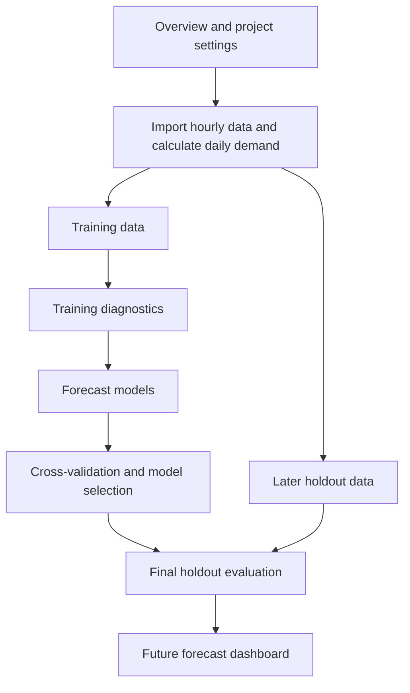

# Electricity-Demand-Forecasting-automation


I turned our ADS-506 time series team project into a website that automates electricity demand forecasting for California, Texas, and New York. Upload hourly EIA data and the app guides you through cleaning the data, comparing models, and checking their accuracy. Then, with one click, you can generate a daily demand forecast, view it on an interactive graph, and download the predictions as a CSV.

## Introduction

Grid Forecast Lab is a web app for the ADS-506 electricity demand forecasting project. It uses hourly electricity demand data from the U.S. Energy Information Administration (EIA) for California, Texas, and New York. The app converts those readings into daily average demand in megawatts (MW), compares forecasting models, and predicts demand for upcoming days.

For example, you can use the app to see which model has the lowest error for California at seven days ahead, then generate daily predictions for the week after the latest usable observation.

## Workflow diagram



## Download and run locally on Windows

1. Open the [Electricity Demand Forecasting repository](https://github.com/SheshmaJ/Electricity-Demand-Forecasting) and select **Code → Download ZIP**.
2. Right-click the downloaded ZIP and choose **Extract All**.
3. Open the folder containing `index.html` in VS Code. If the app files are inside a `grid-forecast-lab` subfolder, open that subfolder.
4. In VS Code, select **Terminal → New Terminal** and run:

   ```powershell
   py -m http.server 8000 --bind 127.0.0.1
   ```

5. Open [http://127.0.0.1:8000/](http://127.0.0.1:8000/) in your browser.
6. Click **Try sample data** to practice, or open **Data & cleaning** to load your own EIA files.

Keep the terminal open while you use the app. Press **Ctrl+C** in the terminal when you want to stop it.

You can also use the [hosted Grid Forecast Lab](https://ads506-grid-forecast-lab.readybadge1025.chatgpt.site) through your browser. To reproduce the analysis in Quarto, open **Python / Quarto** in the app and choose **Download Quarto bundle**.

## What each step does and why it matters

### 1. Overview

**What it does.** Shows the workflow and current project settings. In **Shared settings**, you can choose the regions, date ranges, and forecast horizons. The app defaults to 1, 7, and 14 days ahead.

Check that the settings match your project before running the analysis. A **forecast horizon** is how far ahead you predict. A 7-day forecast contains one prediction per day for seven days.

### 2. Data & cleaning

**What it does.** You upload an EIA workbook or paste hourly readings. The app checks for missing hours, unusual readings, and daylight saving time. It averages usable hourly readings into one daily demand value in MW.

Missing hours can make a daily average misleading. A daylight saving day can legitimately have 23 or 25 hours. The checks help you identify which daily values are usable.

### 3. Training diagnostics

**What it does.** Examines the training data for patterns that may affect forecasting.

| Term | What it means |
| --- | --- |
| **Trend** | The long-term direction of demand, such as a gradual increase. |
| **Seasonality** | A repeating pattern, such as lower demand on weekends. |
| **STL** | Breaks demand into a trend, a repeating seasonal pattern, and the variation left over. |
| **ACF** | Measures how demand on one day relates to demand on earlier days. A **lag of 7** means seven days earlier. |
| **PACF** | Measures the relationship at a given lag after accounting for the shorter lags in between. |
| **Stationarity** | Describes whether the statistical behavior of the series is stable over time. The **ADF** and **KPSS** tests provide evidence about whether differencing may help. **Differencing** means looking at the change between observations. |

These checks show which patterns the models may need to capture. A strong weekly pattern, for example, gives you a reason to try a model that accounts for the day of the week.

### 4. Forecast models

**What it does.** Compares four ways to predict daily demand.

| Model | What it does |
| --- | --- |
| **Seasonal naïve** | Uses the most recent observation from the same weekday. For example, it uses last Monday’s demand to predict this Monday. |
| **ETS** | Uses exponential smoothing to estimate the demand level, trend, and repeating patterns. |
| **ARIMA** | Uses past demand values and forecast errors. Differencing can help it model changes when demand shifts over time. |
| **TSLM** | Uses regression to estimate how demand relates to time and calendar patterns, such as weekdays and weekends. |

Seasonal naïve provides a **baseline**, or reference forecast. Comparing the other models with this baseline shows whether they improve forecast accuracy.

### 5. Cross-validation

**What it does.** Runs practice forecasts at several dates within the training period. At each date, the app fits models using observations available by that date and compares their predictions with the actual demand that followed. It then moves the cutoff forward and repeats. This is called **rolling-origin cross-validation**.

One week may be unusually easy or difficult to predict. Comparing models across several dates helps you choose a model for each region and forecast horizon.

| Metric | What it tells you |
| --- | --- |
| **MAE** | Mean absolute error. An MAE of 500 MW means forecasts missed actual demand by 500 MW on average. The app selects the model with the lowest training cross-validation MAE. |
| **RMSE** | Root mean squared error. It is measured in MW and gives more weight to large misses. |
| **MASE** | Mean absolute scaled error. It compares errors with a weekly seasonal naïve error scale calculated from past observations. A value below 1 means the error is smaller than that reference scale. |
| **ME** | Mean error. The app calculates actual demand minus predicted demand. A positive value means the model tended to predict too low. A negative value means it tended to predict too high. |

### 6. Final holdout

**What it does.** Evaluates the chosen model specifications on a later block of data reserved for final testing. The app compares predictions with the actual demand observed in that period.

**Why it matters.** Cross-validation helps you choose a model. The holdout shows how the fixed choices perform on later data that did not guide model selection.

### 7. Future forecasts

**What it does.** After the holdout evaluation, choose a region and horizon, then click **Generate forecast**. The app refits the model with the lowest training cross-validation MAE for that combination using all usable observations. Predictions start the day after the latest usable observation.

The dashboard answers a question such as “How much electricity demand do we expect in California over the next seven days?” It plots recent actual demand and shows future predictions as a dashed line. The daily prediction table shows values in MW and can be downloaded as a CSV.
